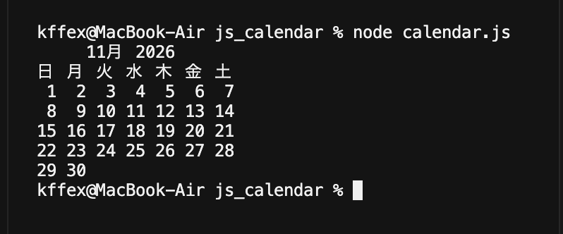
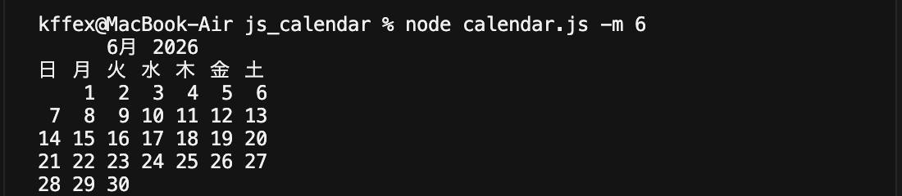
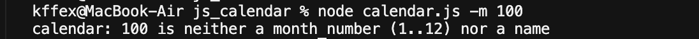

# JavaScriptでカレンダーを作る

`cal` コマンドと同じ見た目のカレンダーを表示するプログラムです。

## 使い方

```
node calendar.js        # 今月のカレンダー
node calendar.js -m 6   # 今年の6月のカレンダー
```

`-m` に 1〜12 以外の値を指定するとエラーになります。

## 実行結果

### node calendar.js



### node calendar.js -m 6



### node calendar.js -m 100


